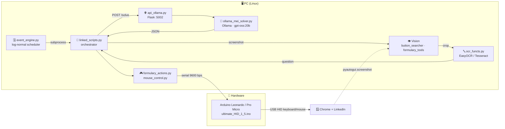
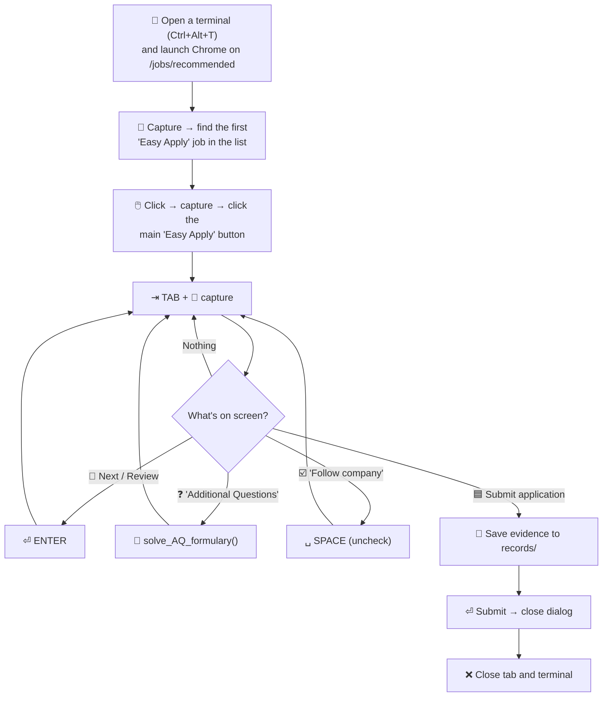

# 🤖 LinkedinBot: Easy Apply with computer vision + a physical HID

A bot that automates LinkedIn **Easy Apply** applications without touching the browser DOM.
It **sees** the screen with OpenCV + OCR, **thinks** with a local LLM (Ollama) and **acts** through an
**Arduino that shows up as a real USB keyboard and mouse**.

> ⚠️ **Educational / portfolio project.** Automating LinkedIn violates its
> [User Agreement](https://www.linkedin.com/legal/user-agreement) and may get your account suspended.
> Use it at your own risk, and always review what the bot answers on your behalf.

---

## 📑 Contents

- [✨ Features](#-features)
- [🧱 Architecture](#-architecture)
- [🔄 Application flow](#-application-flow)
- [🧩 Modules](#-modules)
- [🔌 Hardware: Arduino HID](#-hardware-arduino-hid)
- [🧠 Mei: the question solver](#-mei-the-question-solver)
- [🎲 Human-like behavior](#-human-like-behavior)
- [🛠️ Installation](#️-installation)
- [🚀 Usage](#-usage)
- [📁 Repo layout](#-repo-layout)
- [🚧 Limitations and TODO](#-limitations-and-todo)

---

## ✨ Features

- 👁️ **Visual UI detection** using *template matching* (OpenCV) against PNG crops of buttons and fields.
- 🔤 **Bilingual OCR** (EasyOCR `en` + `es`, with Tesseract as an alternative) to read questions and options.
- 🧠 **Local LLM** (Ollama, `gpt-oss:20b`) served through a Flask API that replies in JSON.
- ⌨️🖱️ **Hardware input**: an Arduino (ATmega32U4) receives commands over serial and executes them as USB HID events.
- 🎲 **Human timing**: log-normal/Gaussian delays, Bézier mouse paths and character-by-character typing.
- 🗓️ **Event engine**: launches applications at random intervals, each in an isolated Python process with a timeout.
- 📸 **Evidence**: saves a screenshot of every form right before submitting (`records/`) plus per-session logs (`logs/`).

---

## 🧱 Architecture



It runs as a **closed perception → decision → action loop**:

```
 ┌──────────────┐    ┌──────────────┐    ┌──────────────┐    ┌──────────────┐
 │ 📸 Capture   │───▶│ 👁️ Detect    │───▶│ 🧠 Decide    │───▶│ ⌨️ Act        │
 │  screen      │    │ button/field │    │ (rules/LLM)  │    │ via Arduino  │
 └──────────────┘    └──────────────┘    └──────────────┘    └──────┬───────┘
        ▲                                                            │
        └──────────────────── UI changes ◀───────────────────────────┘
```

---

## 🔄 Application flow

`main_filler_script()` in [linked_scripts.py](linked_scripts.py):



### ❓ Additional questions

Inside `solve_AQ_formulary()`, each focused field is classified by the *widget* next to it:

| Type | Detected widget | How it's read | How it's answered |
|:---:|---|---|---|
| **1** 📝 | Text field (`key_fill.png`) | OCR of the text above the field | Mei returns text/a number → typed in `HUMAN_LIVE` mode |
| **2** 🔽 | Dropdown (`multi-select.png`) | Walks the options with ↓, OCR-ing each one until the same one repeats 3 times | Mei marks each option `true`/`false` → navigates with ↑/↓ to the chosen one |
| **3** 🔘 | Radio button (`circle-select.png`) | OCR of the text next to the circle | Mei returns a boolean → ↓↑ = *Yes*, ↓ = *No* |

```
 📸 formulary_state.png
        │
        ▼
 ┌────────────────────┐   type + coords   ┌───────────────────┐   text     ┌──────────────┐
 │ search_4_current_  │──────────────────▶│ crop_by_element() │──────────▶│ EasyOCR      │
 │ element()          │                   │ (relative crop)   │           │ en + es      │
 └────────────────────┘                   └───────────────────┘           └──────┬───────┘
                                                                                 │
     ┌──────────────────────┐   {"answer": ...}   ┌──────────────────┐  {"question","type"}
     │ Actions (serial) ⌨️   │◀────────────────────│ POST /solve 🧠   │◀───────────┘
     └──────────────────────┘                     └──────────────────┘
```

Once no more fields are detected, the bot keeps pressing TAB until it finds the next blue button.

---

## 🧩 Modules

| File | Role |
|---|---|
| 🗓️ [event_engine.py](event_engine.py) | Scheduler: waits a log-normal interval (μ=2.71, σ=0.33 → ~15 min) between events and runs each one as a subprocess with a timeout. Tees stdout to `logs/`. |
| 🚪 [event_launcher.py](event_launcher.py) | Entry point for a single event: calls `main_filler_script()`. |
| 🧭 [linked_scripts.py](linked_scripts.py) | Orchestrator: Easy Apply flow, additional questions, and `script_add_contact()` to send invitations from *My Network*. |
| 👁️ [button_searcher.py](button_searcher.py) | Template matching, picking the topmost match, Gaussian noise on coordinates and moving to the button. |
| 📋 [formulary_tools.py](formulary_tools.py) | Detects form widgets and blue buttons (Next/Review/Submit), crops regions and OCRs questions/options. |
| 🔤 [ocr_functs.py](ocr_functs.py) | Tesseract (with preprocessing) and EasyOCR wrappers. |
| 🎮 [formulary_actions.py](formulary_actions.py) | `Actions` class: TAB, ENTER, arrows, mode switching and human-like typing over serial. |
| 🖱️ [mouse_control.py](mouse_control.py) | Bézier paths, calibration, delayed clicks, scrolling and moves to random screen regions. |
| 🌐 [api_ollama.py](api_ollama.py) | Flask API `POST /solve` on top of the solver. |
| 🧠 [ollama_mei_solver.py](ollama_mei_solver.py) | `CloudQuestionSolver`: system prompt, retries and JSON validation. |
| 🔌 [ultimate_HID_1_5/](ultimate_HID_1_5/) | Arduino sketch (current HID firmware). |
| 🧪 [test/event_sim.py](test/event_sim.py) | Simulates the event distribution (no hardware needed). |
| 🗃️ `formulary_st1.py`, `random_pos.py` | Earlier versions / standalone utilities. |

---

## 🔌 Hardware: Arduino HID

You need a board with native USB (**ATmega32U4**: Arduino Leonardo, Micro or Pro Micro) to use the
`Keyboard.h` and `Mouse.h` libraries. To the operating system it looks like just another physical keyboard and mouse.

```
 ┌───────────────┐   USB serial (/dev/ttyACM*)   ┌─────────────────────┐   USB HID   ┌──────────┐
 │  Python       │──────────────────────────────▶│ Arduino 32U4        │────────────▶│  Linux   │
 │  pyserial     │   "TAB\n", "CLICK\n", ...     │ ultimate_HID_1_5    │  keyboard + │  + Chrome│
 │               │◀──────────────────────────────│                     │  mouse      │          │
 └───────────────┘            "OK"               └─────────────────────┘             └──────────┘
```

### Firmware modes

| Mode | Command | Behavior |
|---|---|---|
| 🎯 `COMMAND` | `MODE:COMMAND` | Each line is a command: `TAB`, `KEY_RETURN`, `SPACE`, `ESC`, `UP_ARROW`, `ctrl+w`, `X+`/`Y-`, `CLICK`, `SCROLL DOWN`, `PING`… Anything it doesn't recognize gets typed as-is. |
| ✍️ `HUMAN` | `MODE:HUMAN` | Types the whole line when it receives `\n`. |
| ⚡ `HUMAN_LIVE` | `MODE:HUMAN_LIVE` | Types each character as soon as it arrives, so Python controls the typing rhythm. |
| 🤫 Sentinel `0x02` | `\x02MODE:...` | Suppresses echo until `\n`, so you can switch modes without the command being typed on screen. |
| 📤 `TYPE_ONLY:` | `TYPE_ONLY:text` | Types the text in any mode. |

`ultimate_HID_1_2_ino` through `1_4` are earlier versions of the same firmware.

---

## 🧠 Mei: the question solver

```
 POST http://localhost:5002/solve
 ┌──────────────────────────────────────────────┐        ┌──────────────────────────────┐
 │ {"question": "Years of experience with AWS?",│  ───▶  │ {"answer": 5}                │
 │  "type": 1}                                  │        │                              │
 ├──────────────────────────────────────────────┤        ├──────────────────────────────┤
 │ {"question": "English level?", "type": 2,    │  ───▶  │ {"answers": {"Native": false,│
 │  "options": ["Native", "Professional"]}      │        │   "Professional": true}}     │
 ├──────────────────────────────────────────────┤        ├──────────────────────────────┤
 │ {"question": "Can you work hybrid?",         │  ───▶  │ {"answer": true}             │
 │  "type": 3}                                  │        │                              │
 └──────────────────────────────────────────────┘        └──────────────────────────────┘
```

- 🔁 Up to 3 attempts if the model returns invalid JSON or answers `"Not specified"`.
- 🔢 For type 1 questions that mention *years*, only the number is kept.
- 🧾 The **candidate profile lives in the system prompt** of `CloudQuestionSolver`: edit it to reflect
  your real experience, since those answers are sent to employers on your behalf.

---

## 🎲 Human-like behavior

| Technique | Where | Details |
|---|---|---|
| ⏱️ Log-normal / Gaussian delays | Every module | Pauses between keystrokes, clicks and screenshots, with realistic tails and a hard cap. |
| 〰️ Bézier curves | `mouse_control.generate_trajectory` | The cursor follows curves with random deviation instead of straight lines. |
| 🎯 Coordinate noise | `button_searcher.noisy_coords` | Clicks land near the button's center, never on the exact same pixel. |
| ✍️ Character-by-character typing | `Actions.type_human` | `HUMAN_LIVE` mode with a per-character delay. |
| 🗓️ Spaced-out sessions | `event_engine` | Applications ~10–25 min apart, log-normally distributed. |
| 🧭 Mouse to random regions | `go_to_random_margin_position` | Moves the cursor away after clicking so it doesn't cover the UI. |

---

## 🛠️ Installation

### Requirements

- 🐧 Linux with X11 (uses `pyautogui`, `xdotool` and `Ctrl+Alt+T` to open a terminal; tested on Ubuntu/GNOME).
- 🐍 Python 3.10+
- 🌐 Google Chrome, already logged in to LinkedIn.
- 🦙 [Ollama](https://ollama.com/) with the model pulled.
- 🔌 Arduino Leonardo / Micro / Pro Micro.
- 🔤 Tesseract (optional, only for `get_text`).

### Steps

```bash
# 1. Python dependencies
python3 -m venv .venv && source .venv/bin/activate
pip install -r reqs/requirements_witheasyocr.txt
pip install ollama          # client used by ollama_mei_solver.py

# 2. System dependencies
sudo apt install xdotool tesseract-ocr tesseract-ocr-spa

# 3. Local model
ollama pull gpt-oss:20b

# 4. Firmware: open ultimate_HID_1_5/ultimate_HID_1_5.ino in the Arduino IDE and upload it to the board

# 5. Serial port permissions
sudo usermod -aG dialout $USER   # log out and back in
ls /dev/ttyACM*                  # find the Arduino's port
```

### ⚙️ Configuration

| What | Where |
|---|---|
| Arduino port (`/dev/ttyACM2` by default) | `ARDUINO_PORT` in `linked_scripts.py`, `formulary_actions.py` and `mouse_control.py` |
| Command that opens Chrome / profile | `main_filler_script()` and `script_add_contact()` in `linked_scripts.py` |
| Number of applications and spacing | `__main__` in `event_engine.py` (`total_events`, `mu`, `sigma`, `timeout_minutes`) |
| LLM model | `CloudQuestionSolver(model=...)` |
| Visual templates | `assets/*.png` (re-crop them if your resolution, theme or LinkedIn language changes) |

---

## 🚀 Usage

```bash
# Terminal 1: LLM API
python api_ollama.py

# Terminal 2: a single application
python event_launcher.py

# …or a session of N spaced-out applications
python event_engine.py
```

> 💡 Don't touch the keyboard or mouse while it runs: the Arduino types into whichever window has focus.

---

## 📁 Repo layout

```
LinkedinBot/
├── 🗓️ event_engine.py          # session scheduler
├── 🚪 event_launcher.py        # single-event entry point
├── 🧭 linked_scripts.py        # orchestrator
├── 👁️ button_searcher.py       # template matching + movement
├── 📋 formulary_tools.py       # form detection and OCR
├── 🔤 ocr_functs.py
├── 🎮 formulary_actions.py     # serial actions
├── 🖱️ mouse_control.py         # mouse trajectories
├── 🌐 api_ollama.py            # Flask :5002
├── 🧠 ollama_mei_solver.py     # LLM solver
├── 🖼️ assets/                  # PNG templates of buttons/fields
├── 🔌 ultimate_HID_1_5/        # Arduino firmware
├── 🧪 test/
├── 📦 reqs/
├── 📸 records/                 # (ignored) screenshots taken before submitting
└── 📜 logs/                    # (ignored) per-session logs
```

---

## 🚧 Limitations and TODO

- 📐 Templates and crop offsets depend on **resolution, scaling and theme**; on a different screen you'll need to re-crop them.
- 🔁 Navigation is TAB + screenshot, so each form takes several minutes.
- 🧪 Answers aren't validated before typing (e.g. LinkedIn's numeric ranges).
- ⚙️ TODO: centralize configuration (port, profile, paths) in a `.env` / `config.yaml`.
- 🧹 TODO: clean up test functions (`q*_type_action_test`, `main_script_old`) and legacy modules.
