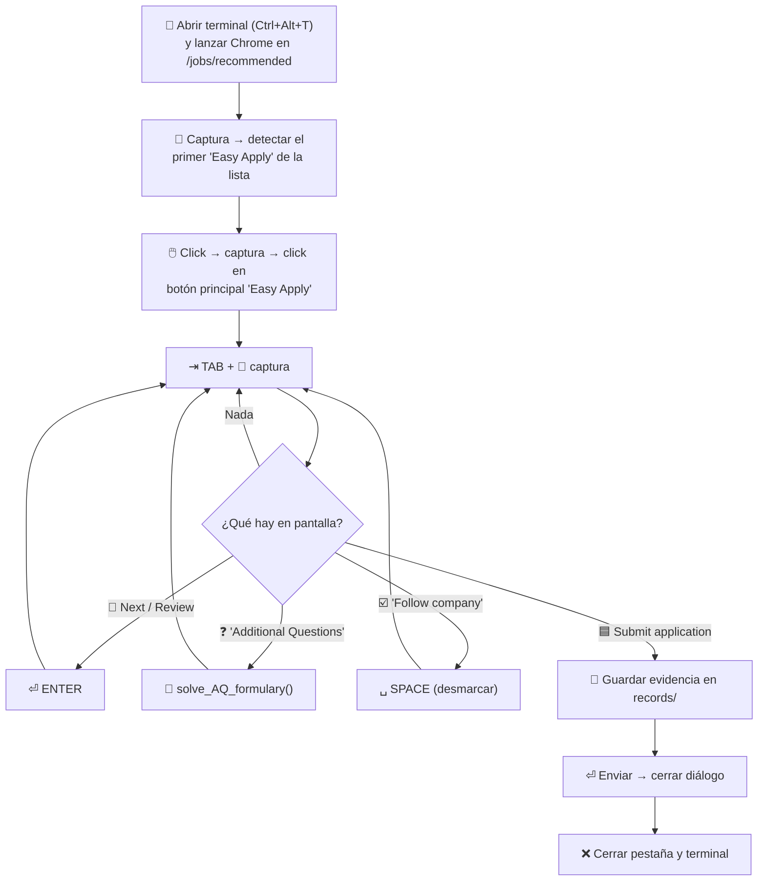

# 🤖 LinkedinBot — Easy Apply con visión por computadora + HID físico

Bot que automatiza postulaciones **Easy Apply** de LinkedIn sin tocar el DOM del navegador:
**ve** la pantalla con OpenCV + OCR, **piensa** con un LLM local (Ollama) y **actúa** mediante un
**Arduino que se presenta como teclado y mouse USB reales**.

> ⚠️ **Proyecto educativo / de portafolio.** Automatizar LinkedIn va contra sus
> [Términos de Servicio](https://www.linkedin.com/legal/user-agreement) y puede terminar en la
> suspensión de tu cuenta. Úsalo bajo tu propio riesgo y revisa siempre lo que el bot responde en tu nombre.

---

## 📑 Contenido

- [✨ Características](#-características)
- [🧱 Arquitectura](#-arquitectura)
- [🔄 Flujo de una postulación](#-flujo-de-una-postulación)
- [🧩 Módulos](#-módulos)
- [🔌 Hardware: Arduino HID](#-hardware-arduino-hid)
- [🧠 Mei: el solver de preguntas](#-mei-el-solver-de-preguntas)
- [🎲 Comportamiento humano](#-comportamiento-humano)
- [🛠️ Instalación](#️-instalación)
- [🚀 Uso](#-uso)
- [📁 Estructura del repo](#-estructura-del-repo)
- [🚧 Limitaciones y TODO](#-limitaciones-y-todo)

---

## ✨ Características

- 👁️ **Detección visual de la UI** por *template matching* (OpenCV) contra recortes PNG de botones y campos.
- 🔤 **OCR bilingüe** (EasyOCR `en` + `es`, Tesseract como alternativa) para leer las preguntas y opciones.
- 🧠 **LLM local** (Ollama, `gpt-oss:20b`) expuesto como API Flask que responde en JSON.
- ⌨️🖱️ **Entrada por hardware**: un Arduino (ATmega32U4) recibe comandos por serial y los ejecuta como HID USB.
- 🎲 **Tiempos humanos**: retardos log-normales/gaussianos, trayectorias Bézier del mouse y tecleo carácter a carácter.
- 🗓️ **Motor de eventos**: lanza postulaciones espaciadas aleatoriamente, cada una en un proceso Python aislado con timeout.
- 📸 **Evidencia**: guarda una captura de cada formulario antes de enviarlo (`records/`) y logs por sesión (`logs/`).

---

## 🧱 Arquitectura


El ciclo es un **lazo cerrado percepción → decisión → acción**:

```
 ┌──────────────┐    ┌──────────────┐    ┌──────────────┐    ┌──────────────┐
 │ 📸 Captura   │───▶│ 👁️ Detecta   │───▶│ 🧠 Decide    │───▶│ ⌨️ Actúa      │
 │  pantalla    │    │ botón/campo  │    │ (reglas/LLM) │    │ vía Arduino  │
 └──────────────┘    └──────────────┘    └──────────────┘    └──────┬───────┘
        ▲                                                            │
        └──────────────────── la UI cambia ◀─────────────────────────┘
```

---

## 🔄 Flujo de una postulación

`main_filler_script()` en [linked_scripts.py](linked_scripts.py):



### ❓ Preguntas adicionales

Dentro de `solve_AQ_formulary()` cada campo enfocado se clasifica por el *widget* que lo acompaña:

| Tipo | Widget detectado | Cómo se lee | Cómo se responde |
|:---:|---|---|---|
| **1** 📝 | Campo de texto (`key_fill.png`) | OCR del texto encima del campo | Mei devuelve texto/número → se teclea en modo `HUMAN_LIVE` |
| **2** 🔽 | Dropdown (`multi-select.png`) | Se recorren las opciones con ↓ y se hace OCR de cada una hasta que se repite 3 veces | Mei marca `true`/`false` por opción → se navega con ↑/↓ hasta la elegida |
| **3** 🔘 | Radio button (`circle-select.png`) | OCR del texto junto al círculo | Mei responde booleano → ↓↑ = *Sí*, ↓ = *No* |

```
 📸 formulary_state.png
        │
        ▼
 ┌────────────────────┐   tipo + coords   ┌───────────────────┐   texto    ┌──────────────┐
 │ search_4_current_  │──────────────────▶│ crop_by_element() │──────────▶│ EasyOCR      │
 │ element()          │                   │ (recorte relativo)│           │ en + es      │
 └────────────────────┘                   └───────────────────┘           └──────┬───────┘
                                                                                 │
     ┌──────────────────────┐   {"answer": ...}   ┌──────────────────┐  {"question","type"}
     │ Actions (serial) ⌨️   │◀────────────────────│ POST /solve 🧠   │◀───────────┘
     └──────────────────────┘                     └──────────────────┘
```

Cuando ya no se detecta ningún campo, el bot avanza con TAB hasta encontrar el siguiente botón azul.

---

## 🧩 Módulos

| Archivo | Rol |
|---|---|
| 🗓️ [event_engine.py](event_engine.py) | Scheduler: espera un tiempo log-normal (μ=2.71, σ=0.33 → ~15 min) entre eventos y ejecuta cada uno como subproceso con timeout. Duplica stdout a `logs/`. |
| 🚪 [event_launcher.py](event_launcher.py) | Punto de entrada de un evento: llama a `main_filler_script()`. |
| 🧭 [linked_scripts.py](linked_scripts.py) | Orquestador: flujo Easy Apply, preguntas adicionales, `script_add_contact()` para enviar invitaciones en *My Network*. |
| 👁️ [button_searcher.py](button_searcher.py) | Template matching, selección del elemento más alto, ruido gaussiano en coordenadas y movimiento hacia el botón. |
| 📋 [formulary_tools.py](formulary_tools.py) | Detección de widgets del formulario, botones azules (Next/Review/Submit), recortes y OCR de preguntas/opciones. |
| 🔤 [ocr_functs.py](ocr_functs.py) | Wrappers de Tesseract (con preprocesado) y EasyOCR. |
| 🎮 [formulary_actions.py](formulary_actions.py) | Clase `Actions`: TAB, ENTER, flechas, cambios de modo y tecleo humano por serial. |
| 🖱️ [mouse_control.py](mouse_control.py) | Trayectorias Bézier, calibración, clicks con retardo, scroll y movimiento a zonas aleatorias. |
| 🌐 [api_ollama.py](api_ollama.py) | API Flask `POST /solve` sobre el solver. |
| 🧠 [ollama_mei_solver.py](ollama_mei_solver.py) | `CloudQuestionSolver`: prompt de sistema, reintentos y validación del JSON. |
| 🔌 [ultimate_HID_1_5/](ultimate_HID_1_5/) | Sketch de Arduino (versión actual del firmware HID). |
| 🧪 [test/event_sim.py](test/event_sim.py) | Simulador de la distribución de eventos (sin hardware). |
| 🗃️ `formulary_st1.py`, `random_pos.py` | Versiones anteriores / utilidades sueltas. |

---

## 🔌 Hardware: Arduino HID

Se necesita una placa con USB nativo (**ATmega32U4**: Arduino Leonardo, Micro o Pro Micro) para usar
las librerías `Keyboard.h` y `Mouse.h`. Para el sistema operativo es un teclado y mouse físicos más.

```
 ┌───────────────┐   USB serial (/dev/ttyACM*)   ┌─────────────────────┐   USB HID   ┌──────────┐
 │  Python       │──────────────────────────────▶│ Arduino 32U4        │────────────▶│  Linux   │
 │  pyserial     │   "TAB\n", "CLICK\n", ...     │ ultimate_HID_1_5    │  teclado +  │  + Chrome│
 │               │◀──────────────────────────────│                     │  mouse      │          │
 └───────────────┘            "OK"               └─────────────────────┘             └──────────┘
```

### Modos del firmware

| Modo | Comando | Comportamiento |
|---|---|---|
| 🎯 `COMMAND` | `MODE:COMMAND` | Cada línea es un comando: `TAB`, `KEY_RETURN`, `SPACE`, `ESC`, `UP_ARROW`, `ctrl+w`, `X+`/`Y-`, `CLICK`, `SCROLL DOWN`, `PING`… Lo que no reconoce lo escribe tal cual. |
| ✍️ `HUMAN` | `MODE:HUMAN` | Escribe la línea completa al recibir `\n`. |
| ⚡ `HUMAN_LIVE` | `MODE:HUMAN_LIVE` | Escribe cada carácter en cuanto llega, así Python controla el ritmo del tecleo. |
| 🤫 Sentinel `0x02` | `\x02MODE:...` | Suprime el eco hasta el `\n` para cambiar de modo sin escribir el comando en pantalla. |
| 📤 `TYPE_ONLY:` | `TYPE_ONLY:texto` | Escribe el texto en cualquier modo. |

`ultimate_HID_1_2_ino` a `1_4` son versiones anteriores del mismo firmware.

---

## 🧠 Mei: el solver de preguntas

```
 POST http://localhost:5002/solve
 ┌──────────────────────────────────────────────┐        ┌──────────────────────────────┐
 │ {"question": "Years of experience with AWS?",│  ───▶  │ {"answer": 5}                │
 │  "type": 1}                                  │        │                              │
 ├──────────────────────────────────────────────┤        ├──────────────────────────────┤
 │ {"question": "English level?", "type": 2,    │  ───▶  │ {"answers": {"Native": false,│
 │  "options": ["Native", "Professional"]}      │        │   "Professional": true}}     │
 ├──────────────────────────────────────────────┤        ├──────────────────────────────┤
 │ {"question": "Can you work hybrid?",         │  ───▶  │ {"answer": true}             │
 │  "type": 3}                                  │        │                              │
 └──────────────────────────────────────────────┘        └──────────────────────────────┘
```

- 🔁 Hasta 3 intentos si el modelo devuelve algo que no es JSON válido o responde `"Not specified"`.
- 🔢 En preguntas de tipo 1 que mencionan *years*, se extrae solo el número.
- 🧾 El **perfil del candidato vive en el prompt de sistema** de `CloudQuestionSolver`: edítalo para que refleje
  tu experiencia real, ya que esas respuestas se envían a empleadores en tu nombre.

---

## 🎲 Comportamiento humano

| Técnica | Dónde | Detalle |
|---|---|---|
| ⏱️ Retardos log-normales / gaussianos | Todos los módulos | Pausas entre teclas, clicks y capturas con colas realistas y tope máximo. |
| 〰️ Curvas de Bézier | `mouse_control.generate_trajectory` | El cursor sigue curvas con desviación aleatoria en lugar de líneas rectas. |
| 🎯 Ruido en coordenadas | `button_searcher.noisy_coords` | El click cae cerca del centro del botón, nunca exactamente en el mismo píxel. |
| ✍️ Tecleo carácter a carácter | `Actions.type_human` | Modo `HUMAN_LIVE` con retardo por carácter. |
| 🗓️ Sesiones espaciadas | `event_engine` | Postulaciones separadas ~10–25 min con distribución log-normal. |
| 🧭 Mouse a zonas aleatorias | `go_to_random_margin_position` | Aparta el cursor tras hacer click para no tapar la UI. |

---

## 🛠️ Instalación

### Requisitos

- 🐧 Linux con X11 (usa `pyautogui`, `xdotool` y `Ctrl+Alt+T` para abrir la terminal; probado en Ubuntu/GNOME).
- 🐍 Python 3.10+
- 🌐 Google Chrome con la sesión de LinkedIn ya iniciada.
- 🦙 [Ollama](https://ollama.com/) con el modelo descargado.
- 🔌 Arduino Leonardo / Micro / Pro Micro.
- 🔤 Tesseract (opcional, solo para `get_text`).

### Pasos

```bash
# 1. Dependencias de Python
python3 -m venv .venv && source .venv/bin/activate
pip install -r reqs/requirements_witheasyocr.txt
pip install ollama          # cliente usado por ollama_mei_solver.py

# 2. Dependencias del sistema
sudo apt install xdotool tesseract-ocr tesseract-ocr-spa

# 3. Modelo local
ollama pull gpt-oss:20b

# 4. Firmware: abre ultimate_HID_1_5/ultimate_HID_1_5.ino en Arduino IDE y súbelo a la placa

# 5. Permisos del puerto serial
sudo usermod -aG dialout $USER   # cierra sesión y vuelve a entrar
ls /dev/ttyACM*                  # identifica el puerto del Arduino
```

### ⚙️ Configuración

| Qué | Dónde |
|---|---|
| Puerto del Arduino (`/dev/ttyACM2` por defecto) | `ARDUINO_PORT` en `linked_scripts.py`, `formulary_actions.py` y `mouse_control.py` |
| Comando para abrir Chrome / perfil | `main_filler_script()` y `script_add_contact()` en `linked_scripts.py` |
| Número de postulaciones y espaciado | `__main__` de `event_engine.py` (`total_events`, `mu`, `sigma`, `timeout_minutes`) |
| Modelo LLM | `CloudQuestionSolver(model=...)` |
| Plantillas visuales | `assets/*.png` (recórtalas de nuevo si cambia tu resolución, tema o idioma de LinkedIn) |

---

## 🚀 Uso

```bash
# Terminal 1 — API del LLM
python api_ollama.py

# Terminal 2 — una sola postulación
python event_launcher.py

# …o una sesión de N postulaciones espaciadas
python event_engine.py
```

> 💡 No toques el teclado ni el mouse mientras corre: el Arduino escribe en la ventana que tenga el foco.

---

## 📁 Estructura del repo

```
LinkedinBot/
├── 🗓️ event_engine.py          # scheduler de sesiones
├── 🚪 event_launcher.py        # entrada de un evento
├── 🧭 linked_scripts.py        # orquestador
├── 👁️ button_searcher.py       # template matching + movimiento
├── 📋 formulary_tools.py       # detección y OCR del formulario
├── 🔤 ocr_functs.py
├── 🎮 formulary_actions.py     # acciones por serial
├── 🖱️ mouse_control.py         # trayectorias del mouse
├── 🌐 api_ollama.py            # Flask :5002
├── 🧠 ollama_mei_solver.py     # solver LLM
├── 🖼️ assets/                  # plantillas PNG de botones/campos
├── 🔌 ultimate_HID_1_5/        # firmware Arduino
├── 🧪 test/
├── 📦 reqs/
├── 📸 records/                 # (ignorado) capturas antes de enviar
└── 📜 logs/                    # (ignorado) logs por sesión
```

---

## 🚧 Limitaciones y TODO

- 📐 Las plantillas y offsets de recorte dependen de la **resolución, escala y tema**; en otra pantalla hay que recortarlas de nuevo.
- 🔁 La navegación es por TAB + captura, así que cada formulario tarda varios minutos.
- 🧪 No hay validación de la respuesta antes de teclearla (p. ej. rangos numéricos de LinkedIn).
- ⚙️ Pendiente: centralizar la configuración (puerto, perfil, rutas) en un `.env` / `config.yaml`.
- 🧹 Pendiente: limpiar funciones de prueba (`q*_type_action_test`, `main_script_old`) y módulos legacy.
